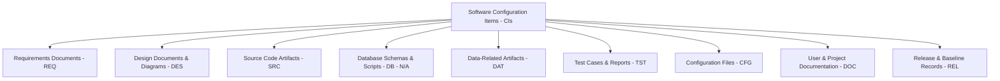
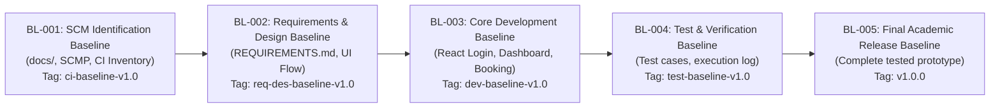

# Software Configuration Identification Document

**Project Title:** Multi-Hotel Booking and Management Platform  
**Academic Course:** Software Configuration Management (SCM) – AASTU  
**Document Identifier:** DOC-004  
**Document Version:** 1.0.0  
**Baseline Association:** Baseline BL-001 (Initial Configuration Identification Baseline)  
**Date:** November 9, 2026  
**Primary Standards & References:** IEEE Std 828-2012 / AASTU SCM Week 5: SCM Plan and Tools  
**Author / Responsible Role:** Configuration Manager  

---

## 1. Executive Summary and Purpose

### 1.1 Purpose of Configuration Identification
Configuration Identification is the foundational activity of Software Configuration Management (SCM). According to IEEE Std 828-2012 and the AASTU SCM Week 5 curriculum, configuration identification is the systematic process of:
1. Selecting the discrete software artifacts, documentation items, datasets, and configurations that must be placed under formal SCM control throughout the engineering lifecycle.
2. Grouping those items into logical functional categories.
3. Assigning unique, immutable, and human-readable identifiers to each item.
4. Defining physical and logical storage architectures within the version-controlled repository.
5. Establishing naming conventions, versioning semantics, and ownership responsibilities.
6. Grouping related versions of configuration items into formally agreed baselines that serve as frozen reference foundations for subsequent development.

Without rigorous configuration identification, development teams face artifact confusion, uncoordinated modifications, untracked changes, inability to reproduce prior working releases, and loss of traceability between requirements, source code, and test evidence.

### 1.2 Purpose of this Document
This document establishes the official configuration identification framework for the **Multi-Hotel Booking and Management Platform** project. It specifies the criteria for CI selection, defines the CI taxonomy, outlines unique identifier schemas, assigns role responsibilities, details repository storage structures, explains change tracking and versioning mechanics, establishes the baseline governance protocol, and includes the master Configuration Item Inventory table.

---

## 2. Project Scope and Applicability Boundaries

### 2.1 Project Overview
The Multi-Hotel Booking and Management Platform is an academic software project representing a centralized web application where prospective guests can browse multiple hotels, inspect room availability and amenities, and initiate room bookings.

### 2.2 Prototype Implementation Scope
For the current course deliverables, the project scope is deliberately constrained to a lightweight, standalone **React.js single-page application (SPA)** prototype. The prototype encompasses:
1. **Login and Authentication Demonstration Screen:** A mock authentication view demonstrating simulated login, credential validation, and session state toggling.
2. **Main Hotel Catalog Dashboard:** A responsive display rendering a collection of hotels, room types, pricing, and availability indicators.
3. **Core Room Booking Action:** An interactive booking modal/form allowing users to select dates, room types, enter guest details, and submit a reservation.
4. **Browser-Side Data Persistence:** Utilizing browser `localStorage` to persist demonstration booking submissions and simulate session continuity.

### 2.3 Technology Stack
The technical boundaries of the prototype consist strictly of:
- **Framework & Language:** React.js, modern JavaScript (ES6+), HTML5, CSS3.
- **Build & Development Tooling:** Node.js, Vite/npm, Visual Studio Code, Browser Developer Tools.
- **Version Control & Collaboration:** Git (local version control) and GitHub (remote repository hosting, Issue tracking, Pull Request peer review).
- **Data Layer:** Static JSON mock dataset for the initial hotel catalog (`src/data/hotels.json`) and browser `localStorage` for booking records.

### 2.4 Applicability Boundaries & Exclusions
To maintain academic honesty and prevent scope creep, the following boundaries are formally established:
- **No Database Server or SQL Engine:** The prototype does not include a relational database management system (RDBMS) such as PostgreSQL, MySQL, or SQLite, nor a cloud NoSQL database server. Browser `localStorage` provides demonstration client-side persistence and must never be misrepresented as a production database server.
- **No Production Backend:** There is no server-side runtime (e.g., Express, Spring Boot, Django) or remote REST/GraphQL API.
- **No Commercial Gateways:** External payment processors, third-party global distribution systems (GDS), and live hotel inventory APIs are strictly out of scope.
- **Configuration Item Boundary:** Only artifacts created, managed, or directly configured by the project team inside the Git repository are treated as configuration items. External third-party libraries (e.g., React runtime modules inside `node_modules`) are managed via dependency manifests (`package.json`, `package-lock.json`) rather than tracking their internal files as individual CIs.

---

## 3. Configuration Item Selection Criteria

In accordance with IEEE Std 828-2012, not every temporary file generated during development qualifies as a Configuration Item (CI). An artifact is selected and designated as a CI if it satisfies one or more of the following five criteria:

1. **Technical and Functional Criticality:**
   - Any artifact that directly governs or alters user-visible behavior, application rendering, core business logic, or mock data handling (e.g., React components, booking algorithms, static hotel datasets).
2. **Volatility and Collaborative Evolution:**
   - Artifacts that undergo iterative modifications by multiple team members across the project lifecycle and therefore require change control, branch isolation, and regression prevention (e.g., source files, stylesheets, test suites).
3. **Rebuildability and Environment Reproducibility:**
   - Artifacts required to clone, configure, build, execute, and verify the identical state of the software across heterogeneous developer workstations without manual patching (e.g., `package.json`, `package-lock.json`, `.gitignore`, `vite.config.js`).
4. **Traceability and Lifecycle Alignment:**
   - Documents and models that articulate requirements, UI navigation flows, architectural structures, and verification evidence, enabling bidirectional traceability between problem space, design, implementation, and testing (e.g., requirements documents, architecture diagrams, test reports).
5. **Academic and SCM Governance Accountability:**
   - Formal plans, baseline audit records, inventory registers, and compliance documents required by course milestones, instructor evaluations, and IEEE Std 828-2012 standards compliance (e.g., `SCMP.md`, `CONFIGURATION_IDENTIFICATION.md`, `INITIAL_CONFIGURATION_BASELINE.md`).

---

## 4. Configuration Item Taxonomy and Classification

The project categorizes all identified CIs into nine distinct categories. Each category addresses a specific engineering facet of the academic prototype:



### 4.1 Requirements Documents (`REQ`)
Captures functional capabilities, user personas, operational constraints, demonstration scope, and acceptance criteria. Essential for establishing the Requirements Baseline.
- *Identified CI:* `REQ-001` (Software Requirements Specification - SRS).

### 4.2 Design Documents and Diagrams (`DES`)
Specifies the visual interface wireframes, navigation transitions between the login page, dashboard, and booking modal, component hierarchy trees, and state management patterns.
- *Identified CIs:* `DES-001` (UI Navigation Flow and Wireframes), `DES-002` (Frontend System Architecture and State Specification).

### 4.3 Source Code Artifacts (`SRC`)
The core implementation files developed using React.js, JSX, JavaScript, and CSS. Governs the application entry point, simulated login logic, hotel list presentation, booking submission dialog, and global styles.
- *Identified CIs:* `SRC-001` (Application Entry Point and Root Container), `SRC-002` (Login Page), `SRC-003` (Hotel Dashboard), `SRC-004` (Room Booking Component), `SRC-005` (Global Stylesheets).

### 4.4 Database Schemas and Scripts (`DB`) — Honest Applicability Assessment
- **Assessment Finding:** **Not Applicable (N/A).**
- **Technical Rationale:** The course assignment mandates evaluating database schemas and scripts as an SCM category. For this academic project, the agreed technical scope is strictly a client-side React prototype running entirely inside the web browser. There is no relational database server (e.g., PostgreSQL, Oracle), SQL script library, DDL migration pipeline, or NoSQL database daemon.
- **SCM Treatment:** To maintain absolute academic transparency, `DB-001` is formally registered in the inventory and baseline records with status **Not Applicable**, explicitly documenting why no SQL scripts exist. The browser-side data structures used for the prototype are classified under Data-Related Artifacts (`DAT`).

### 4.5 Data-Related Artifacts (`DAT`)
Controls the client-side data structures and demonstration data utilized by the prototype without requiring a live backend.
- *Identified CIs:* `DAT-001` (Sample Hotel Catalog Dataset - `hotels.json`), `DAT-002` (Browser LocalStorage Booking Schema Specification - `storage.js`).

### 4.6 Test Cases and Test Reports (`TST`)
Defines the manual verification scenarios, acceptance test suites, execution logs, and defect tracking reports verifying that the prototype fulfills requirements.
- *Identified CIs:* `TST-001` (Functional Test Cases Specification), `TST-002` (Test Execution Log and Verification Report).

### 4.7 Configuration Files (`CFG`)
Machine-readable configuration files controlling dependency resolution, module bundling, build scripts, development server options, and version control filtering.
- *Identified CIs:* `CFG-001` (`package.json`), `CFG-002` (`package-lock.json`), `CFG-003` (`.gitignore`), `CFG-004` (`vite.config.js`).

### 4.8 Project and User Documentation (`DOC`)
Human-readable documentation guiding setup, execution, architectural understanding, and SCM governance.
- *Identified CIs:* `DOC-001` (Project README and Setup Guide), `DOC-002` (Prototype User and Demonstration Guide), `DOC-003` (Software Configuration Management Plan - SCMP), `DOC-004` (Configuration Identification Document), `DOC-005` (CI Naming Conventions and Versioning Standards).

### 4.9 Release and Baseline Records (`REL`)
Formal governance records certifying the verification and freeze of configuration baselines, release audit notes, and the master inventory register.
- *Identified CIs:* `REL-001` (Initial Project Configuration Baseline Record), `REL-002` (Configuration Item Inventory Register).

---

## 5. Unique Identification and Numbering Scheme

Every CI is assigned a unique alphanumeric code formatted as:

$$\langle\text{CATEGORY}\rangle\text{-}\langle\text{000}\rangle$$

1. **Category Prefix:** A standard 2-to-3 character code (`REQ`, `DES`, `SRC`, `DB`, `DAT`, `TST`, `CFG`, `DOC`, `REL`).
2. **Hyphen Separator:** A literal `-`.
3. **Sequential Number:** A 3-digit zero-padded number starting from `001` within that category.

### 5.1 Rules of Identifier Integrity
- **Global Uniqueness:** No two configuration items across the entire repository may share the same ID.
- **Persistence:** An assigned ID remains permanent across all revisions and baselines.
- **No Recycling:** If an item is deprecated or retired, its ID is flagged as *Retired/Obsolete* in the inventory and never reassigned to a subsequent artifact.
- **Traceability Tagging:** Developers must reference the CI ID in Git commit messages, Pull Request descriptions, and test case documents.

---

## 6. Configuration Item Ownership and Role Responsibilities

SCM requires clear organizational assignment of responsibility for each CI to prevent unauthorized edits and establish clear points of contact for change evaluations:

| Project Role | Designated Role Holder | SCM Responsibilities & CI Ownership | Owned CI IDs |
|:---|:---|:---|:---|
| **Configuration Manager** | Configuration Manager | Maintains SCMP, establishes baselines, creates Git tags, enforces naming conventions, audits CI repository layout, maintains inventory. | `CFG-001`–`CFG-004`, `DOC-003`–`DOC-005`, `REL-001`–`REL-002` |
| **Project Manager** | Project Manager / Team Lead | Approves baselines, chairs Change Control Board (CCB), reviews major change requests, coordinates course milestone submissions. | `REQ-001`, `DOC-001`, Baseline Sign-off |
| **Lead Architect / Designer** | Project Team | Develops UI wireframes, page flow models, component interaction diagrams, state management schemas. | `DES-001`, `DES-002`, `DAT-002` |
| **Frontend Developer** | Project Team | Implements React components, JSX views, CSS styling, mock data bindings, and localStorage utilities on feature branches. | `SRC-001`–`SRC-005`, `DAT-001` |
| **Test Engineer / QA Lead** | Project Team | Authors test cases, executes functional and browser verification, documents defect logs and baseline verification sign-offs. | `TST-001`, `TST-002` |
| **Database Administrator** | Project Team | Formally designated role to evaluate data storage requirements. Concluded that dedicated RDBMS is Not Applicable. | `DB-001` (N/A assessment) |

---

## 7. Storage and Repository Architecture

All configuration items are stored in a centralized Git repository. The directory hierarchy reflects functional categorization and separates documentation, source code, mock data, and test records:

```text
multi-hotel-booking/ (Repository Root)
├── .gitignore                          [CFG-003: Git ignore filters]
├── package.json                        [CFG-001: Node manifest & dependencies]
├── package-lock.json                   [CFG-002: Deterministic lockfile]
├── vite.config.js                      [CFG-004: Vite bundler configuration]
├── README.md                           [DOC-001: Project overview & setup]
├── docs/                               [Documentation & SCM Governance]
│   ├── SCMP.md                         [DOC-003: Software Configuration Management Plan]
│   ├── CONFIGURATION_IDENTIFICATION.md [DOC-004: Configuration Identification Document]
│   ├── CI_NAMING_CONVENTIONS.md        [DOC-005: CI Naming & Versioning Conventions]
│   ├── INITIAL_CONFIGURATION_BASELINE.md [REL-001: Initial Baseline BL-001 Record]
│   ├── CI_INVENTORY.csv                [REL-002: Master CI Inventory Register]
│   ├── REQUIREMENTS.md                 [REQ-001: Software Requirements Specification]
│   ├── USER_GUIDE.md                   [DOC-002: Prototype User Demonstration Guide]
│   └── design/                         [Design & Modeling Artifacts]
│       ├── UI_NAVIGATION_FLOW.md       [DES-001: UI wireframes and navigation flow]
│       └── ARCHITECTURE_OVERVIEW.md    [DES-002: Architecture & state specification]
├── public/                             [Public Static Web Assets]
│   └── favicon.ico                     [Browser icon]
├── src/                                [React Application Source Root]
│   ├── main.jsx                        [SRC-001: Application bootstrap entry point]
│   ├── App.jsx                         [SRC-001: Root component & layout container]
│   ├── components/                     [Reusable React Components]
│   │   └── BookingModal.jsx            [SRC-004: Room booking interaction modal]
│   ├── pages/                          [Primary View Components]
│   │   ├── Login.jsx                   [SRC-002: Authentication demonstration page]
│   │   └── Dashboard.jsx               [SRC-003: Hotel catalog dashboard page]
│   ├── data/                           [Static Demonstration Datasets]
│   │   └── hotels.json                 [DAT-001: Static sample hotel catalog]
│   ├── styles/                         [CSS Stylesheets]
│   │   ├── index.css                   [SRC-005: Global design tokens and reset]
│   │   └── App.css                     [SRC-005: Application-wide component styles]
│   └── utils/                          [Utility Modules]
│       └── storage.js                  [DAT-002: Browser localStorage helper utility]
└── tests/                              [Verification & Testing Artifacts]
    ├── TEST_CASES.md                   [TST-001: Functional test cases specification]
    └── TEST_REPORT.md                  [TST-002: Test execution log & audit report]
```

### 7.1 Separation of Existing vs. Planned Artifacts
To ensure complete transparency during the initial phase of the project:
- **Existing Artifacts (Established in Baseline BL-001):** The core SCM documentation suite (`docs/SCMP.md`, `docs/CONFIGURATION_IDENTIFICATION.md`, `docs/CI_NAMING_CONVENTIONS.md`, `docs/INITIAL_CONFIGURATION_BASELINE.md`, and `docs/CI_INVENTORY.csv`).
- **Planned Artifacts (Scheduled for Iterative Implementation):** React source files (`src/*`), static mock data (`src/data/hotels.json`), build manifests (`package.json`), test documentation (`tests/*`), and user guides (`docs/USER_GUIDE.md`). These are mapped to their intended paths but are explicitly marked as *Planned* with version *Not Yet Established*.

---

## 8. Configuration Item Change Tracking and Version Control

### 8.1 Tracking Mechanism via Git and GitHub
Every change to a configuration item is tracked through Git version control:
1. **Cryptographic Immutability:** Git calculates a 40-character SHA hash for every tree, blob, and commit. This provides cryptographic verification that no change occurs undetected.
2. **Change Requests via GitHub Issues:** Formal change proposals to baseline items must be submitted as GitHub Issues stating:
   - Request summary and business rationale.
   - Target CI identifier(s) affected (e.g., `Affects: SRC-003, REQ-001`).
   - Impact assessment (scope, regression risk, documentation update needs).
3. **Branch Isolation:** Changes are implemented on isolated feature branches (`feature/hotel-dashboard`, `docs/ci-identification`) branched off `develop`.
4. **Peer Review via Pull Requests:** A Pull Request (PR) must be submitted and reviewed before merging. The PR must pass peer verification and receive formal approval from the Project Manager or Configuration Manager.
5. **Traceable Commit Messages:** Commit messages must follow Conventional Commits format referencing the CI ID (e.g., `feat(dashboard): add hotel card filtering [SRC-003]`).

---

## 9. Baseline Establishment and Lifecycle Evolution

A baseline is a formally approved version of a configuration item, or collection of items, established at a specific milestone in the software lifecycle. Once established, a baseline is frozen and serves as the official reference point; subsequent changes require formal review and approval.

### 9.1 Baseline Roadmap
The project defines five sequential milestone baselines across its lifecycle:



1. **Baseline BL-001 (Initial Configuration Identification Baseline):**
   - **Focus:** SCM governance documents, CI inventory, naming standards, initial repository state.
   - **Status:** **Established & Frozen** upon completion of Task 2.
   - **Annotated Git Tag:** `ci-baseline-v1.0`.
2. **Baseline BL-002 (Requirements and Design Baseline):**
   - **Focus:** Freezing `REQ-001`, `DES-001`, `DES-002`.
   - **Milestone:** Week 2 design approval.
3. **Baseline BL-003 (Core Development Baseline):**
   - **Focus:** Integration of React prototype components (`SRC-001` through `SRC-005`), mock data (`DAT-001`), and localStorage persistence (`DAT-002`).
   - **Milestone:** Week 5 core booking completion.
4. **Baseline BL-004 (Test & Verification Baseline):**
   - **Focus:** Execution of test cases (`TST-001`), logging defect resolutions (`TST-002`), and verifying acceptance criteria.
   - **Milestone:** Week 7 testing review.
5. **Baseline BL-005 (Final Release Baseline):**
   - **Focus:** End-to-end verified academic submission including user guide (`DOC-002`), final audit sign-off, and clean demonstration code.
   - **Milestone:** Week 8 release candidate. Tag: `v1.0.0`.

---

## 10. Configuration Item Inventory Maintenance Procedure

To keep the configuration item inventory accurate and prevent configuration drift throughout the project, team members must adhere to the following maintenance procedure:

1. **Identification of New Artifacts:**
   - Whenever a developer or team member proposes introducing a new artifact (e.g., an additional React component, a new helper script, or a new test report), they must notify the Configuration Manager during sprint planning or via a GitHub Issue.
2. **Category Assignment & Numbering:**
   - The Configuration Manager determines whether the proposed artifact meets the CI selection criteria (Section 3).
   - If accepted, the Configuration Manager assigns the next sequential identifier in that category (e.g., `SRC-006` or `DOC-006`).
3. **Register Updating:**
   - The Configuration Manager updates `docs/CI_INVENTORY.csv` and the inventory table in `docs/CONFIGURATION_IDENTIFICATION.md` to reflect the new item, its planned path, and the responsible role.
4. **Status Transitions:**
   - When an artifact transitions from *Planned* to *Implemented*, its status is updated to *Existing*, its version is incremented from *Not Yet Established* to `1.0.0`, and its baseline inclusion is documented in the next baseline release record.
5. **Periodic Reconciliation & Surveillance:**
   - During weekly surveillance checks, the Configuration Manager inspects repository changes against the inventory to ensure no untracked files or unauthorized changes exist.

---

## 11. Master Configuration Item (CI) Inventory

The following table provides the human-readable master inventory of all software configuration items identified for the Multi-Hotel Booking and Management Platform project. This table corresponds exactly to `docs/CI_INVENTORY.csv`:

| CI ID | CI Name | Category | Description | Repository Location | Lifecycle Status | Current Version | Responsible Role | Baseline Status |
|:---|:---|:---|:---|:---|:---|:---|:---|:---|
| **REQ-001** | Software Requirements Specification (SRS) | Requirements | Defines functional requirements for login demo, hotel list dashboard, room booking action, and localStorage persistence. | `docs/REQUIREMENTS.md` | Planned | Not Yet Established | Project Manager / Analyst | Pending (BL-002) |
| **DES-001** | UI Navigation Flow and Wireframes | Design | Visual wireframes, page structure layout, and transition flow for login, hotel catalog, and booking modal. | `docs/design/UI_NAVIGATION_FLOW.md` | Planned | Not Yet Established | UI/UX Designer / Developer | Pending (BL-002) |
| **DES-002** | Frontend Architecture and State Specification | Design | Defines React component hierarchy, state flow, props contracts, and browser localStorage data management. | `docs/design/ARCHITECTURE_OVERVIEW.md` | Planned | Not Yet Established | Architect / Lead Developer | Pending (BL-002) |
| **SRC-001** | Application Entry Point and Root Container | Source Code | Application bootstrap, React DOM root mounting, routing shell, and primary application layout container. | `src/main.jsx`, `src/App.jsx` | Planned | Not Yet Established | Frontend Developer | Pending (BL-003) |
| **SRC-002** | Login and Authentication Demonstration Page | Source Code | React component demonstrating simulated user login, credential validation, and authenticated session state. | `src/pages/Login.jsx` | Planned | Not Yet Established | Frontend Developer | Pending (BL-003) |
| **SRC-003** | Hotel Catalog Dashboard Page | Source Code | React dashboard displaying list of hotels, room availability badges, pricing, and booking action triggers. | `src/pages/Dashboard.jsx` | Planned | Not Yet Established | Frontend Developer | Pending (BL-003) |
| **SRC-004** | Room Booking Interaction Component | Source Code | Interactive modal/form capturing guest booking details, date selection, room type, and triggering localStorage save. | `src/components/BookingModal.jsx` | Planned | Not Yet Established | Frontend Developer | Pending (BL-003) |
| **SRC-005** | Global Application Stylesheets | Source Code | CSS design tokens, responsive layout rules, form styling, and visual theme presentation rules. | `src/styles/App.css`, `src/styles/index.css` | Planned | Not Yet Established | Frontend Developer | Pending (BL-003) |
| **DB-001** | Relational Database Schemas and Migration Scripts | Database Schemas & Scripts | Production SQL DDL/DML scripts and database schemas. Evaluated as Not Applicable: project scope is strictly client-side React with localStorage. | Not Applicable | Not Applicable | Not Applicable | Database Administrator | Not Applicable |
| **DAT-001** | Sample Hotel Catalog Dataset | Data-related Artifacts | Static JSON dataset containing initial demonstration hotels, room types, pricing, amenities, and availability. | `src/data/hotels.json` | Planned | Not Yet Established | Data Analyst / Developer | Pending (BL-003) |
| **DAT-002** | Browser LocalStorage Booking Schema Specification | Data-related Artifacts | Specification and JavaScript utility module defining the schema and CRUD operations for demonstration booking records in localStorage. | `src/utils/storage.js` | Planned | Not Yet Established | Lead Developer | Pending (BL-003) |
| **TST-001** | Functional Test Cases Specification | Test Cases & Reports | Test scenarios, manual test steps, and acceptance criteria for login demo, hotel browsing, room booking, and localStorage. | `tests/TEST_CASES.md` | Planned | Not Yet Established | Test Engineer | Pending (BL-004) |
| **TST-002** | Test Execution Log and Verification Report | Test Cases & Reports | Test execution logs, pass/fail verification results, defect tracking records, and baseline verification sign-offs. | `tests/TEST_REPORT.md` | Planned | Not Yet Established | Test Engineer | Pending (BL-004) |
| **CFG-001** | Node.js Package Manifest | Configuration Files | NPM package configuration defining project metadata, build scripts (dev, build, preview), and React/Vite dependencies. | `package.json` | Planned | Not Yet Established | Configuration Manager | Pending (BL-003) |
| **CFG-002** | Dependency Lockfile | Configuration Files | Deterministic lockfile pinning exact versions, package hashes, and dependency trees for reproducible builds. | `package-lock.json` | Planned | Not Yet Established | Configuration Manager | Pending (BL-003) |
| **CFG-003** | Git Version Control Ignore Rules | Configuration Files | Ignore filters preventing tracking of node_modules, build outputs, local cache files, and IDE settings. | `.gitignore` | Planned | Not Yet Established | Configuration Manager | Pending (BL-001) |
| **CFG-004** | Frontend Bundler Build Configuration | Configuration Files | Vite/bundler configuration file controlling build settings, module aliases, and dev-server parameters. | `vite.config.js` | Planned | Not Yet Established | Configuration Manager | Pending (BL-003) |
| **DOC-001** | Project README and Setup Guide | User Documentation | Project introduction, prerequisites, local setup instructions, repository structure, and execution walkthrough. | `README.md` | Planned | Not Yet Established | Project Manager / Writer | Pending (BL-003) |
| **DOC-002** | Prototype User and Demonstration Guide | User Documentation | Comprehensive user guide walking instructors and evaluators through testing login, hotel browsing, and room booking. | `docs/USER_GUIDE.md` | Planned | Not Yet Established | Technical Writer | Pending (BL-005) |
| **DOC-003** | Software Configuration Management Plan (SCMP) | SCM Documentation | Primary SCM governing standard defining CM organization, procedures, baseline schedule, change control, and audits. | `docs/SCMP.md` | Existing | 1.0.0 | Configuration Manager | Included (BL-001) |
| **DOC-004** | Configuration Identification Document | SCM Documentation | Official specification of CI identification criteria, categories, storage layout, tracking, and baseline mechanisms. | `docs/CONFIGURATION_IDENTIFICATION.md` | Existing | 1.0.0 | Configuration Manager | Included (BL-001) |
| **DOC-005** | CI Naming Conventions and Versioning Standards | SCM Documentation | Formal rules governing CI identifier formats, file/folder naming, semantic versioning, Git branch workflows, and commit messages. | `docs/CI_NAMING_CONVENTIONS.md` | Existing | 1.0.0 | Configuration Manager | Included (BL-001) |
| **REL-001** | Initial Project Configuration Baseline Record | Release & Baseline Records | Formal record establishing Baseline BL-001 (Initial Configuration Identification Baseline), with Git commit reference and audit sign-off. | `docs/INITIAL_CONFIGURATION_BASELINE.md` | Existing | 1.0.0 | Configuration Manager / PM | Included (BL-001) |
| **REL-002** | Configuration Item Inventory Register | Release & Baseline Records | Controlled master inventory CSV register listing all identified configuration items, locations, lifecycle states, and baselines. | `docs/CI_INVENTORY.csv` | Existing | 1.0.0 | Configuration Manager | Included (BL-001) |

---

## 12. Verification and Compliance Sign-Off

This document and the associated configuration item inventory have been prepared and reviewed in accordance with IEEE Std 828-2012 and the AASTU SCM Week 5 curriculum requirements.

- **Prepared By:** Configuration Manager — November 9, 2026  
- **Reviewed & Approved By:** Project Management / Course Instructor (Academic Review)  
- **Associated Baseline:** Baseline BL-001 (Initial Configuration Identification Baseline)

