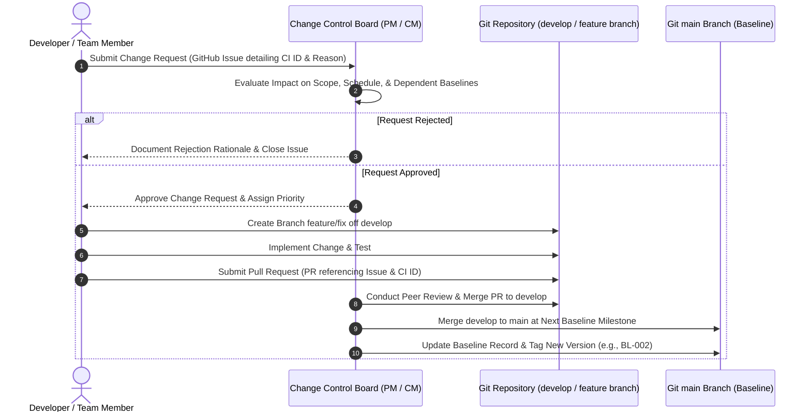

# Initial Project Configuration Baseline Record

**Baseline Identifier:** BL-001  
**Baseline Title:** Initial Configuration Identification Baseline  
**Document Identifier:** REL-001  
**Document Version:** 1.0.0  
**Project Title:** Multi-Hotel Booking and Management Platform  
**Academic Course:** Software Configuration Management (SCM) – AASTU  
**Establishment Date:** November 9, 2026  
**Governing Standard:** IEEE Std 828-2012 / AASTU SCM Week 5 Guidelines  
**Responsible Role:** Configuration Manager  
**Status:** Established and Frozen for SCM Governance  

---

## 1. Baseline Overview and Purpose

### 1.1 Purpose
A configuration baseline represents a formally reviewed and agreed specification or product that serves as the basis for further development, and that can be changed only through formal change control procedures (IEEE Std 828-2012).

The purpose of **Baseline BL-001 (Initial Configuration Identification Baseline)** is to establish the controlled reference point for the project's governance framework, configuration identification taxonomy, naming standards, and configuration item inventory for the Multi-Hotel Booking and Management Platform.

### 1.2 Baseline Scope
Baseline BL-001 establishes the foundational SCM documentation and rules before any frontend application source code or build dependencies are added. It freezes:
1. The Software Configuration Management Plan (`docs/SCMP.md`).
2. The Configuration Identification Document (`docs/CONFIGURATION_IDENTIFICATION.md`).
3. The Master Configuration Item Inventory Register (`docs/CI_INVENTORY.csv`).
4. The CI Naming Conventions and Versioning Standards (`docs/CI_NAMING_CONVENTIONS.md`).
5. This Initial Project Configuration Baseline Record (`docs/INITIAL_CONFIGURATION_BASELINE.md`).

---

## 2. Repository and Version Control Context

In accordance with strict academic reporting standards, the repository state is recorded as follows:

- **Local Repository Name:** `multi-hotel-booking-scm`
- **Local Working Path:** `C:\Users\user\Documents\School\Assignment\Configurations Project`
- **Remote GitHub Repository URL:** `https://github.com/beimnetmelese/multi-hotel-booking-scm.git`
- **Git Branch:** `main` (the official release and milestone branch)
- **Baseline Git Tag:** `ci-baseline-v1.0` (Annotated Git tag created on the baseline commit)
- **Baseline Git Commit Reference:** The cryptographic SHA-1 commit hash of the commit establishing this baseline. (To retrieve the exact commit hash from the repository, run `git rev-parse ci-baseline-v1.0` or inspect `git log -1 ci-baseline-v1.0`).

---

## 3. Configuration Items Included in Baseline BL-001 (Existing Artifacts)

The following configuration items have been authored, verified, and placed under formal baseline control within Baseline BL-001. Each item is marked with status **Existing** and baseline status **Included**:

| CI ID | CI Name | Category | Repository Location | Version | Baseline Status | Role Responsible |
|:---|:---|:---|:---|:---|:---|:---|
| **DOC-003** | Software Configuration Management Plan (SCMP) | SCM Documentation | `docs/SCMP.md` | 1.0.0 | Included | Configuration Manager |
| **DOC-004** | Configuration Identification Document | SCM Documentation | `docs/CONFIGURATION_IDENTIFICATION.md` | 1.0.0 | Included | Configuration Manager |
| **DOC-005** | CI Naming Conventions and Versioning Standards | SCM Documentation | `docs/CI_NAMING_CONVENTIONS.md` | 1.0.0 | Included | Configuration Manager |
| **REL-001** | Initial Project Configuration Baseline Record | Release & Baseline Records | `docs/INITIAL_CONFIGURATION_BASELINE.md` | 1.0.0 | Included | Configuration Manager / Project Manager |
| **REL-002** | Configuration Item Inventory Register | Release & Baseline Records | `docs/CI_INVENTORY.csv` | 1.0.0 | Included | Configuration Manager |

---

## 4. Planned Configuration Items (Pending Future Baselines)

The following items have been identified and registered in the inventory, but have not yet been developed. They represent the planned development roadmap and are categorized by the milestone baseline in which they will be incorporated:

### 4.1 Pending Baseline BL-002: Requirements & Design Baseline
- **`REQ-001`**: Software Requirements Specification (`docs/REQUIREMENTS.md`) – Planned, Version Not Yet Established.
- **`DES-001`**: UI Navigation Flow and Wireframes (`docs/design/UI_NAVIGATION_FLOW.md`) – Planned, Version Not Yet Established.
- **`DES-002`**: Frontend Architecture and State Specification (`docs/design/ARCHITECTURE_OVERVIEW.md`) – Planned, Version Not Yet Established.

### 4.2 Pending Baseline BL-003: Core Development Baseline
- **`CFG-001`**: Node.js Package Manifest (`package.json`) – Planned.
- **`CFG-002`**: Dependency Lockfile (`package-lock.json`) – Planned.
- **`CFG-003`**: Git Version Control Ignore Rules (`.gitignore`) – Planned.
- **`CFG-004`**: Frontend Bundler Build Configuration (`vite.config.js`) – Planned.
- **`SRC-001`**: Application Entry Point and Root Container (`src/main.jsx`, `src/App.jsx`) – Planned.
- **`SRC-002`**: Login and Authentication Demonstration Page (`src/pages/Login.jsx`) – Planned.
- **`SRC-003`**: Hotel Catalog Dashboard Page (`src/pages/Dashboard.jsx`) – Planned.
- **`SRC-004`**: Room Booking Interaction Component (`src/components/BookingModal.jsx`) – Planned.
- **`SRC-005`**: Global Application Stylesheets (`src/styles/App.css`, `src/styles/index.css`) – Planned.
- **`DAT-001`**: Sample Hotel Catalog Dataset (`src/data/hotels.json`) – Planned.
- **`DAT-002`**: Browser LocalStorage Booking Schema Specification (`src/utils/storage.js`) – Planned.
- **`DOC-001`**: Project README and Setup Guide (`README.md`) – Planned.

### 4.3 Pending Baseline BL-004: Test & Verification Baseline
- **`TST-001`**: Functional Test Cases Specification (`tests/TEST_CASES.md`) – Planned.
- **`TST-002`**: Test Execution Log and Verification Report (`tests/TEST_REPORT.md`) – Planned.

### 4.4 Pending Baseline BL-005: Final Academic Release Baseline
- **`DOC-002`**: Prototype User and Demonstration Guide (`docs/USER_GUIDE.md`) – Planned.

---

## 5. Items Marked Not Applicable (N/A) with Justification

| CI ID | CI Name | Category | Status | Technical Justification |
|:---|:---|:---|:---|:---|
| **`DB-001`** | Relational Database Schemas and Migration Scripts | Database Schemas & Scripts | **Not Applicable** | The course assignment guidelines require assessing database schemas and scripts as a standard SCM category. For this project, the implementation scope is strictly an academic, client-side React prototype. It runs entirely inside the client browser. There is no database server (e.g., PostgreSQL, MySQL, SQLite), ORM, or backend SQL database engine. Demonstration booking state is preserved using browser `localStorage` and static mock data is stored in `hotels.json`. Storing data in browser `localStorage` is client-side storage, not a database server. Therefore, database schemas and DDL scripts are formally evaluated and recorded as Not Applicable. |

---

## 6. Baseline Authority, Responsibilities, and Approval

- **Baseline Lead / Configuration Manager:** Configuration Manager  
  - *Responsibilities:* Compiles documentation artifacts, verifies file structure against naming conventions, initiates baseline commit on `main`, applies annotated tag `ci-baseline-v1.0`, and maintains status accounting.
- **Project Manager / Team Lead:**  
  - *Responsibilities:* Reviews completeness of deliverables against AASTU SCM Task 2 objectives, ensures alignment with IEEE Std 828-2012, and authorizes freezing Baseline BL-001.
- **Course Lecturer / Instructor Evaluation:**  
  - *Academic Role:* Reviews baseline deliverables against course requirements for final grading.

---

## 7. Change Control Procedure Post-Baseline Establishment

Now that Baseline BL-001 is established, no direct modifications to any baseline artifact are permitted. Any proposed alteration must follow the strict change control procedure defined in `docs/SCMP.md`:

1. **Change Request Submission:** Any team member desiring a change to a baselined document must submit a GitHub Issue describing the need, justification, and affected CI IDs.
2. **Impact Assessment:** The Configuration Manager and Project Manager assess the impact on downstream requirements, design, and implementation activities.
3. **Approval:** The Change Control Board (Project Manager and Configuration Manager) approves or rejects the request.
4. **Implementation & Branching:** Approved changes are carried out on a dedicated branch (e.g., `docs/scmp-update` or `feature/<name>`) and never directly on `main`.
5. **Peer Review:** A Pull Request is opened with mandatory review approval.
6. **Re-baselining:** The baseline record (`REL-001`) and CI inventory (`REL-002`) are updated, and a new baseline or patch version is tagged.

---

## 8. Verification and Sign-Off Certificate

I hereby certify that Baseline BL-001 has been established in accordance with the Software Configuration Management Plan (`docs/SCMP.md`) and IEEE Std 828-2012. All included items are present in the repository, correctly categorized, and uniquely identified. No unauthorized changes or implementation code have been introduced at this stage.

**Signed:**  
Configuration Manager  
*Multi-Hotel Booking and Management Platform*  
Date: November 9, 2026

